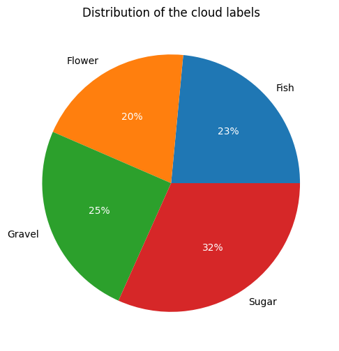

# Segmentation of cloud regions

## EDA

...

## Markdown basics

### VSCode addons

- [Markdown Preview Enhanced](https://marketplace.visualstudio.com/items?itemName=shd101wyy.markdown-preview-enhanced) by Yiyi Wang: Among others, it adds the function `Markdown: Open Preview to the Side` to VSCode. This function (shortcut: `<CTRL k, v>`) shows the rendered Markdown file directly in VSCode .. almost like in Word:-)
- [Markdown All in one](https://marketplace.visualstudio.com/items?itemName=yzhang.markdown-all-in-one) by Yu Zhang:
    - `<Ctrl i>` Make selected text *italic*
    - `<Ctrl b>` Make selected text **bold**
    - When you have a link url in clipboard, select a word and paste it with `<Ctrl v>` an Markdown link is created automatically
    - It has the function `Markdown all in one: Toggle Code block` that surrounds the selected text lines with three backticks to mark it as code. I have manually set this function in VSCode preferences to keyboard shortcut `Alt b`.
    - Another code function: `Markdown all in one: Toggle Code span`. Works great for inline code. I manually set it to the shortcut `Alt a`
- [Markdown Table](https://marketplace.visualstudio.com/items?itemName=TakumiI.markdowntable) by Takumi Ishii: Good for editing markdown tables

### Formatting

#### Figures

We should save the figures to be used in the directory `reports/figures`. Then a figure can be insert into Markdown by `Drag'n'drop it into the editor while holding down Shift key`. Just like this:

#### Tables

In the most basic way they are done like this:

| Column right aligned | Info                                                | Column centered |
| -------------------: | --------------------------------------------------- | :-------------: |
|                 3.14 | Note: even formatting like **bold** etc is possible |       yes       |
|                 1.21 | Or *italic* or `code`.                              |    it works     |

The addon above helps to navigate the cells with tabulator key.

#### Formulas

[LaTeX formulas](https://www.overleaf.com/learn/latex/Mathematical_expressions) can be used inline when writing them between single dollar signs like `$ \formula $` or as blocks when using double-dollar-sings `$$ \formula $$`

Here an example of an inline formula: $RMSE = \sqrt{ \mathbb{E}\left[(\hat{y} - y)^2 \right]}$. Yeah, we've seen that a few times already.

And some formula block examples:

 $$
\hat{X} = \frac{1}{n} \sum_{i=1}^{n} x_i
 $$

$$\min_{\beta_1,\dots \beta_p} \sum\limits_{i=1}^n \left(y_i - \sum\limits_{i=j}^p\beta_j x_{i,j} \right)^2 + \alpha \left( \lambda\sum\limits_{i=j}^p \big|\beta_{j}\big| + (1-\lambda) \sum\limits_{i=j}^p\beta_{j}^2 \right) $$

$$\min_{\beta}\left(\left|\left| Y - X\beta \right|\right|^2 + \alpha \left|\left|\ beta \right|\right|_1 \right)$$

$$y_i=ß_0+ß_1x_{i,1}+ß_2x_{i,2}+\dots+ß_px_{i,p}+\varepsilon_i$$
