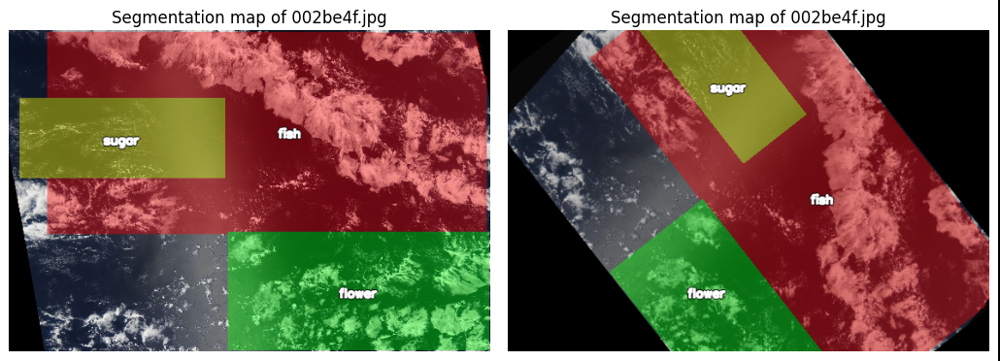

# Segmentation of cloud regions

## Data Augmentation

For the need of data augmentation let me just quote *Aurélien Géron* from the 2025 release of his book [Hands-On Machine Learning with Scikit-Learn and PyTorch](https://www.oreilly.com/library/view/hands-on-machine-learning/9798341607972/), p. 438:

> Data augmentation artificially increases the size of the training set by generating many realistic variants of each training instance. This reduces overfitting, making this a regularization technique. The generated instances should be as realistic as possible: ideally, given an image from the augmented training set, a human should not be able to tell whether it was augmented or not. Simply adding white noise will not help; the modifications should be learnable (white noise is not).
>
> For example, you can slightly shift, rotate, and resize every picture in the training set by various amounts and add the resulting pictures to the training set (...). To do this, you can use tools available in `torchvision.transforms.v2` (e.g., `RandomCrop`, `RandomRotation`, etc.). This forces the model to be more tolerant to variations in the position, orientation, and size of the objects in the pictures. You can similarly use transforms to tweak the colors, and contrasts to simulate many different lighting conditions. In general, you can also flip the pictures horizontally (except for text and other asymmetrical objects). By combining these transformations (using Compose), you can greatly increase your training set size.

So, basically we use it to

- get the model to be more tolerant to variations in the data
- show the model a different variant of each image in every epoch

The second point deserves a remark, because here we deviate slightly from the way Géron describes it above. He adds the generated variants to the training set, which makes that set physically larger. We instead augment *on the fly*: the transformations are applied inside our `Dataset` every time an image is requested (see [Where the pipeline is applied](#where-the-pipeline-is-applied) below). So the number of images per epoch stays exactly the same, but the model practically never sees the very same picture twice. The regularizing effect Géron describes is the same, only the training set size on disk is not affected.

### The library: albumentations

With this in mind we explored some (few) libraries and found the [albumentations](https://albumentations.ai/docs/) package quite promising and ready for the task. Using it, gives us these benefits:

- It is well prepared for image augmentation and also augments the masks, which in our case are the labels. More precisely, and that is what matters for a segmentation task: geometric transformations (flips, rotation) are applied identically to the image and to all of its masks, while photometric ones (brightness, contrast) are applied to the image only. Doing this by hand would be tedious and error-prone.
- In opposite to the `imgaug` package, which we had examined at the beginning of the project, this one is actively maintained and runs with current Python versions

One note on reproducibility: the package we actually install is `albumentationsx` (see `requirements.txt`), the actively maintained successor of `albumentations`. It is a drop-in replacement and is still imported as `albumentations`, which is why all code below reads `import albumentations as A`.

### Setting up the pipeline

Setting it up is quite easy:

```python
import albumentations as A

pipeline = A.Compose([
    A.HorizontalFlip(p=0.3),
    A.VerticalFlip(p=0.3),
    A.RandomBrightnessContrast(p=0.8),
    A.Rotate(p=0.6)
])

# Call the pipeline giving it an image and the stack of its masks
# NOTE: `csi` is an instance of our custom class `CloudSegmentationImage` which 
# gathers the image together with the labels (the masks)
transformed_data = pipeline(
    image=csi.get_image_rgb(),
    masks=csi.get_mask_stack()
)
```

Every transformation has its own probability `p`, so each call produces a different combination. Why we picked these four:

- **`HorizontalFlip` and `VerticalFlip`**: our images are satellite images and therefore have no canonical "up". A flipped satellite image is still a perfectly plausible satellite image, which is exactly the kind of realism Géron asks for. For everyday photos the vertical flip would be a bad idea, an upside-down car is not a realistic training instance.
- **`Rotate`**: same argument, and it additionally makes the model less dependent on the orientation of the cloud formations.
- **`RandomBrightnessContrast`**: simulates different lighting conditions, i.e. different sun angles and times of the day. We gave it the highest probability, but deliberately kept the default (moderate) limits: brightness and texture are part of what distinguishes the cloud types here, so a too aggressive color transformation would damage the very signal we want to learn.

Two details that matter for the masks:

- `Rotate` has to fill the corners that become empty after the rotation. With the default settings this is a constant fill with 0, both for the image (black corners) and for the masks (background), so no cloud region is invented in those areas.
- The masks are resampled with nearest-neighbour interpolation (the default `mask_interpolation`), so they stay strictly binary and no intermediate values sneak into the labels.

The concrete `p` values were chosen heuristically as a reasonable starting point. We did not tune them, so they remain a candidate for a later optimization.

### Where the pipeline is applied

The pipeline is handed over to our `CloudSegmentationDataset`, which applies it in `__getitem__`, that is once per image and epoch:

```python
train_dataset = CloudSegmentationDataset(
    train_labels_df, TRAIN_PATH, pipeline=pipeline
)

# No augmentation for validation, so it reflects real-world performance
val_dataset = CloudSegmentationDataset(val_labels_df, TRAIN_PATH, pipeline=None)
```

Augmenting the training set only is essential here: the validation set has to stay untouched, otherwise its score would no longer describe the performance on real, unmodified data. On top of that it would change from epoch to epoch for reasons that have nothing to do with the model.

### The result

The figure below shows one image with its mask overlay, once in the original and once after passing through the pipeline. Note how the masks follow the geometric transformations of the image:



How much the augmentation actually contributes to the model quality is discussed together with the training results in the model chapters.
